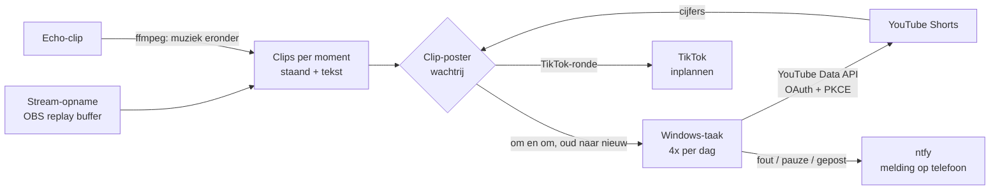

# Stream-tools voor playingparentsnl

[](https://github.com/freed-cloud/stream-tools/actions/workflows/tests.yml)

Twee eigen Windows-programma's die het werk rond onze Twitch-stream **playingparentsnl** automatiseren.
Ik ben Freddy den Haan uit Venlo. Ik zoek een BBL-plek in IT-support, en dit project laat zien hoe ik werk:
een echt probleem zien, uitzoeken hoe het op te lossen is, het bouwen, en het goed testen.

| Programma | Probleem | Oplossing |
| --- | --- | --- |
| **Stream-check** | Een Windows-update veranderde ongemerkt de headset, en onze stream had ruim 7 uur geen geluid. | Eén knop die vóór het live gaan Windows, het geluid, internet en OBS controleert. |
| **Clip-poster** | Clips posten op YouTube en TikTok kostte elke dag veel klikken, en ging soms mis (verkeerd kanaal, dubbel, verkeerde volgorde). | Een wachtrij die zelf de volgorde bepaalt en 4 keer per dag automatisch op YouTube post, met controles en meldingen op de telefoon. |

Beide draaien op **Windows PowerShell 5.1**, dat standaard in Windows zit. Er hoeft niets extra geïnstalleerd te worden (alleen ffmpeg voor de muziekfunctie).

---

## De concepten

### 1. Een wachtrij die zichzelf controleert
De Clip-poster zoekt zelf alle clips die klaar zijn om te posten en bepaalt de volgorde:
- per game van oud naar nieuw, en **om en om GTA 6 en Arma Reforger** (andere games af en toe ertussen);
- clips die al gepost zijn, dubbel staan, geen tekst hebben of nog muziek nodig hebben, worden overgeslagen en gemeld;
- de titel komt uit dezelfde tekst als de beschrijving, zodat titel en tekst altijd bij elkaar passen.

### 2. Automatisch posten met veiligheidsnetten
Een Windows-taak post elke dag om 12:07, 16:04, 19:06 en 21:03 de volgende clip op YouTube, ook als het venster dicht is.
- **Juiste kanaal:** gaat een upload naar een ander kanaal, dan telt hij niet als gepost en stopt het automatisch posten.
- **Nooit dubbel:** de status wordt vlak voor elke upload opnieuw ingelezen, en een slot zorgt dat venster en taak nooit tegelijk uploaden.
- **Veilig opslaan:** eerst naar een tijdelijk bestand, dan in één keer vervangen. Is het statusbestand toch kapot, dan stopt het programma in plaats van alles opnieuw te posten.
- **Half gekopieerde video's** worden niet geüpload.
- **Fouten zijn zichtbaar:** in het logboek, onderaan het venster en als pushmelding op de telefoon (via de app ntfy).

### 3. Muziek onder clips met echo
Eén stream had echo. In plaats van die clips weg te gooien zet de Clip-poster er automatisch muziek onder met **ffmpeg**:
het spelgeluid gaat zachter, de muziek wisselt per clip en loopt aan het eind uit. Het beeld wordt alleen gekopieerd, dus er gaat geen kwaliteit verloren.
Raakt de voorraad GTA-clips op, dan maakt de automatische taak er zelf nieuwe bij.

### 4. Wat niet automatisch kan, zo makkelijk mogelijk
TikTok laat automatisch posten alleen toe voor goedgekeurde apps. Daarom zet de **TikTok-ronde** alle clips één voor één klaar
(tekst op het klembord, video geselecteerd, uploadpagina open) en stelt hij per clip een inplantijd voor, tot 10 dagen vooruit.
Instagram doen we bewust met de hand: Instagram blokkeert accounts die met hulpprogramma's posten.

### 5. Leren van de cijfers
De knop **Cijfers** haalt de weergaven op en laat zien welke game en welk posttijdstip het best werken.

---

## Hoe het in elkaar zit



| Onderdeel | Techniek |
| --- | --- |
| Venster | WinForms vanuit PowerShell 5.1 |
| Inloggen bij Google | OAuth 2.0 met PKCE en state-controle, lokale redirect op 127.0.0.1 |
| Uploaden | YouTube Data API v3, hervatbare upload, op de achtergrond (venster blijft reageren) |
| Inlogsleutel bewaren | Windows DPAPI (alleen leesbaar voor het eigen Windows-account) |
| Automatisch posten | Windows Taakplanner, als gewone gebruiker (geen beheerdersrechten nodig) |
| Muziek | ffmpeg (`amix`, `afade`, video ongewijzigd gekopieerd) |
| Meldingen | ntfy.sh (alleen korte meldingen, geen inloggegevens) |

---

## Testen

De map [`tests`](tests) bootst onze echte mappen na: echte bestandsnamen, echte teksten en de echte bestandsgroottes (gedeeld door 1000).
[`Run-Tests.ps1`](tests/Run-Tests.ps1) controleert onder andere:
- de volgorde van de wachtrij (om en om, oud naar nieuw) en dat er niets in staat wat er niet in hoort;
- dat er nooit dubbel gepost wordt, ook niet als venster en taak tegelijk werken;
- dat een upload naar het verkeerde kanaal niet meetelt en posten pauzeert;
- dat een kapot statusbestand niet leidt tot opnieuw posten;
- de muziekfunctie met echte video's (geluid aanwezig, lengte gelijk, muziek wisselt).

Bij elke wijziging draaien de tests automatisch via **GitHub Actions** op een echte Windows-machine met
Windows PowerShell 5.1 (zoals op de stream-pc), en daarnaast met PowerShell 7 op Windows en Linux. Zie het groene vinkje bovenaan.

Tijdens het bouwen heb ik de code ook laten nakijken door aparte AI-reviewers (Claude-agents), die los van elkaar zochten
naar fouten, Windows-verschillen en of het programma doet wat het moet doen. Hun bevindingen (onder andere dubbel posten
en het gedrag van PowerShell 5.1 bij foutmeldingen van ffmpeg) zijn opgelost en hebben nu een eigen test.

Zelf draaien:
```powershell
powershell -NoProfile -ExecutionPolicy Bypass -File tests\Run-Tests.ps1
```

---

## Installeren en gebruiken

### Stream-check
1. Open OBS en ga naar **Tools > WebSocket-serverinstellingen**. Zet de server en authenticatie aan (poort 4455) en kopieer het wachtwoord.
2. Dubbelklik op **StreamCheck\Start Stream-check.bat**, klik op **Instellingen** en plak het wachtwoord.
3. Voor elke stream: **Check alles**. Pas als alles groen is, ga je live.

### Clip-poster
1. Maak in [Google Cloud](https://console.cloud.google.com) een project, zet de **YouTube Data API v3** aan, stel het toestemmingsscherm in (Extern)
   en maak een **OAuth-client-ID** van het type **Desktop-app**. Download het JSON-bestand.
2. Dubbelklik op **ClipPoster\Start Clip-poster.bat**, klik op **YouTube instellen**, kies het JSON-bestand en log in. Kies het juiste kanaal.
3. Klik op **Automatisch posten** om de Windows-taak aan te zetten, en eventueel op **Muziek eronder** en **Telefoon**.

Dagelijks werk daarna: één keer op **TIKTOK-RONDE** klikken (of één keer per week, met inplannen).

---

## Beveiliging
Zie [SECURITY.md](SECURITY.md). Kort: geen geheimen in deze repository, inlogsleutels versleuteld met DPAPI, OAuth met PKCE, en alleen de rechten die nodig zijn.

## Status
Gebouwd in november 2026 samen met Claude (Anthropic). In gebruik op de stream-pc van playingparentsnl sinds 27 november 2026.
